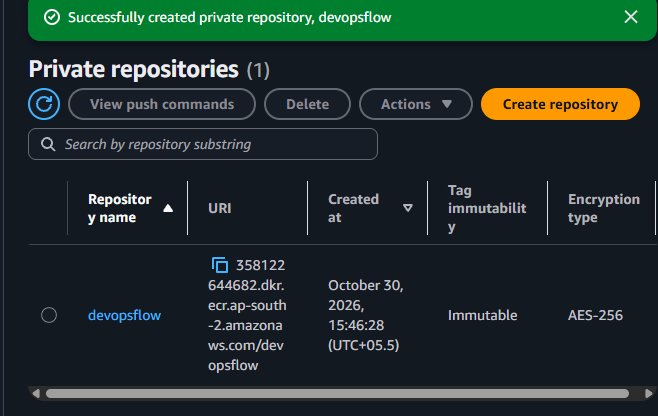
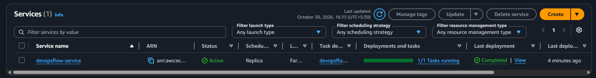
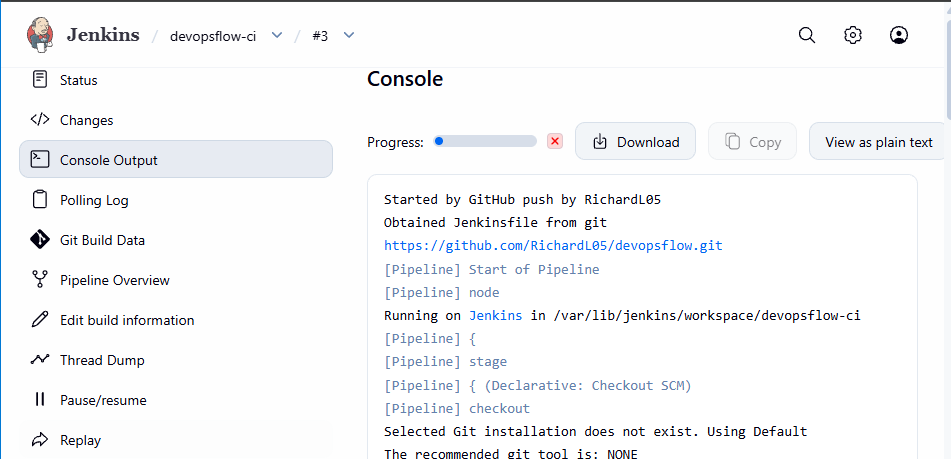
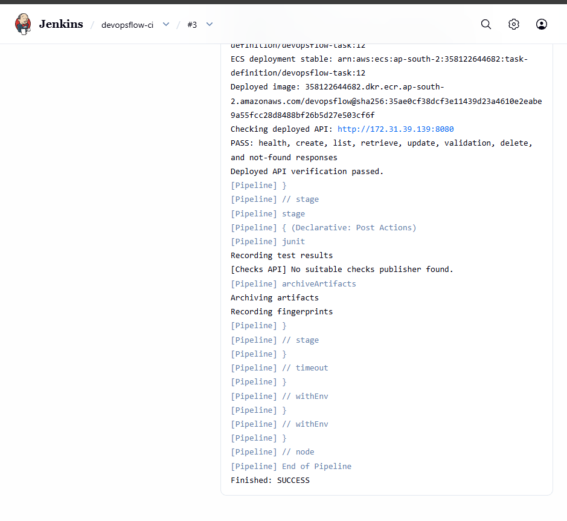

# DevOpsFlow — Automated CI/CD Deployment to AWS Fargate

This document records the project setup, delivery steps, and verified screenshots. Code is referenced by filename only. Each file is identified at the setup step where it belongs.

## 1. What this project does

A change merged into GitHub main starts Jenkins. Jenkins builds a supplied Java application, runs its tests, creates a Docker image, pushes it to Amazon ECR, and deploys it to ECS Fargate. It then checks that the new application works.

This is a DevOps learning project. The Java to-do API and its tests were supplied with assistant help. The learner configured the tools and AWS resources and verified the results. The API is a sample workload; developing new application features is outside this guide.

GitHub push → Jenkins → Maven → Docker → ECR → ECS Fargate → Health and API checks

| Tool | Simple purpose |
| --- | --- |
| GitHub | Store the source, Dockerfile, and Jenkinsfile |
| Jenkins | Run the delivery steps |
| Maven | Turn Java source into a JAR and run tests |
| Docker | Put the JAR and Java runtime into an image |
| ECR | Store images |
| ECS Fargate | Run the application container |
| IAM role | Give AWS permissions without saved access keys |
| Security group | Control network access |

## 2. Environment used

Region: Hyderabad, ap-south-2. Existing repository: RichardL05/devopsflow.

| Resource | Name or setting |
| --- | --- |
| Jenkins EC2 name | devopsflow_server |
| Selected instance type | m7i-flex.large |
| Selected disk | 30 GiB gp3 |
| OS | Ubuntu 26.04 LTS, x86-64 |
| EC2 security group | devopsflow_server_sg |
| EC2 IAM role | devopsflow-ec2-role |
| ECR repository | devopsflow |
| ECS cluster | devopsflow-cluster |
| ECS service | devopsflow-service |
| Task family / container | devopsflow-task / devopsflow |
| Fargate size | 0.25 vCPU, 0.5 GB |
| Desired tasks | 1 |

The selected instance type and disk are user-provided setup choices. Terminal evidence showed about 7.6 GiB RAM and a 28 GiB root filesystem; an EC2 instance-details screenshot was not supplied to independently verify every launch setting.

This guide describes the rebuilt environment. Earlier builds and the failure-recovery exercise are historical results, not builds of this guide.

## 3. Create the Jenkins server through AWS Console

In EC2, launch Ubuntu with the settings above and the existing dedicated key pair. Choose a public subnet, enable public IPv4, and attach devopsflow-ec2-role. Use IMDSv2.

Initially allow SSH port 22 from My IP. Port 80 was included in the selected configuration, but the project does not use a web server on that port. Add TCP 8080 when Jenkins is ready. The learner chose public HTTP access for this lab; this is not a production access pattern.

Connect with EC2 Instance Connect. Run the installation and verification files from the EC2 terminal, not on your personal computer.

## 4. Install Jenkins and Java 21

We checked the [official Jenkins Ubuntu instructions](https://www.jenkins.io/doc/book/installing/linux/). The installation script will use that repository method. The -y option accepts package installation; it does not change the installed packages.

**File: 01-install-jenkins.sh**

Step 4: Run this installation file in the EC2 terminal before opening the Jenkins setup page.

Open http://YOUR_EC2_PUBLIC_IP:8080. Retrieve the setup password locally:

**File: 02-unlock-jenkins.sh**

Step 4: Run this file in the same EC2 terminal. Copy the displayed password into the Unlock Jenkins page; keep it private.

Paste it into Jenkins, install suggested plugins, create an administrator, and finish setup. Never save the password in this document or GitHub.

Observed: Jenkins 2.580.2, Java 21.0.12.1, service active, setup completed. Jenkins URL configuration was skipped by the user. After an EC2 stop/start, update the browser and webhook addresses if the public IP changes; an ordinary reboot normally preserves it.

## 5. Install Docker and allow Jenkins access

Use [Docker's official Ubuntu repository method](https://docs.docker.com/engine/install/ubuntu/):

**File: 03-install-docker.sh**

Step 5: Run this file in the EC2 terminal after Jenkins setup. Confirm the Hello from Docker result.

Docker's documented package list also includes an optional multi-container plugin. It was installed with the vendor package list, but it is not used in this project. The planned installation file will keep only the tools required for this project.

Using Docker's [group-access instructions](https://docs.docker.com/engine/install/linux-postinstall/), grant the jenkins user access and restart its service:

**File: 04-allow-jenkins-docker.sh**

Step 5: Run this file in the EC2 terminal after Docker installation. It restarts Jenkins; wait until no build is running. Verify both Docker Client and Server output.

Docker group access grants root-equivalent privileges on this dedicated learning server. Observed: Docker 29.9.2, Hello from Docker, and both Client and Server sections under the Jenkins user.

## 6. Install Java 17 and Maven

Java 21 runs Jenkins. Java 17 builds our sample application.

Sources: [Ubuntu OpenJDK installation](https://ubuntu.com/developers/docs/howto/java-setup/) and [Apache Maven installation](https://maven.apache.org/install.html).

**File: 05-install-java-maven.sh**

Step 6: Run this file in the EC2 terminal to install the application build tools.

The verification script chooses Java 17 only for that shell. It is project configuration, not an extra software installer.

**File: 06-verify-java-maven.sh**

Step 6: Run this file in the EC2 terminal after installation. It checks the tools as the Jenkins user; confirm Java 17 and Maven output.

Observed: Java and javac 17.0.20.1; Maven 3.9.12 using Java 17.

The pipeline runs mvn -B -ntp clean verify. clean removes the earlier generated build files. verify runs Maven's build lifecycle and configured checks. -B and -ntp reduce interactive/progress output. The JAR is target/devopsflow-0.0.1-SNAPSHOT.jar.

## 7. Install AWS CLI and attach the role

In AWS IAM, create the EC2 role using ec2-trust.json under Trust relationships. Add ecr-push-pull.json, ecs-deployment.json, and ecs-task-discovery.json as inline permission policies under Permissions → Add permissions → Create inline policy → JSON. Replace account and region placeholders first, then attach the role to EC2. For this step, use AWS Console; do not run the JSON files in a shell.

The learner installed the Ubuntu package:

**File: 07-install-aws-cli.sh**

Step 7: Run this file in the EC2 terminal and confirm the AWS CLI version.

Observed: AWS CLI 2.31.35. This was the distribution package, not AWS's own installer. AWS's [installation guide](https://docs.aws.amazon.com/cli/latest/userguide/getting-started-install.html) notes that AWS does not maintain third-party APT packages. An earlier attempt with the AWS installer stopped because unzip was missing.

In EC2 → instance → Actions → Security → Modify IAM role, attach devopsflow-ec2-role. Verify:

**File: 08-verify-aws-role.sh**

Step 7: Run this file in the EC2 terminal after attaching the IAM role. Confirm the returned ARN names devopsflow-ec2-role.

Observed ARN contained assumed-role/devopsflow-ec2-role. No aws configure or stored access keys were used.

The role's existing permissions allow ECR authentication and image push/pull, ECS service updates, task definition registration/read, task discovery, and passing the execution role to ECS. These permissions were reused from the earlier setup. The policy filenames and role assignments are listed below.

## 8. Recreate ECR in AWS Console

ECR → Private repositories → Create repository:
- Name: devopsflow.
- Tag mutability: Immutable.
- Encryption: AES-256.
- Region: Hyderabad.

Observed screenshot confirmed these settings. Repository URI:
358122644682.dkr.ecr.ap-south-2.amazonaws.com/devopsflow

A repository URI is a storage location. An image URI selects an image, for example:
358122644682.dkr.ecr.ap-south-2.amazonaws.com/devopsflow:build-1

## 9. Connect Jenkins to GitHub and publish the first image

File: Jenkinsfile.bootstrap. In the Jenkins job, select Definition → Pipeline script and paste this file into the Script box. Save and run the first build. Use this temporary pipeline before creating the ECS service.

In Jenkins → Manage Jenkins → Credentials → System → Global credentials, add:
- Kind: Username with password.
- Username: RichardL05.
- Password: the repository-restricted GitHub token.
- ID: github-devopsflow.

Do not put the token in a repository URL or this document.

Create a Pipeline job named devopsflow-ci. During the rebuild, a temporary inline pipeline ran only Checkout, Build and Test, Build Docker Image, and Push to ECR. It used the same commands as the Jenkinsfile in Jenkinsfile, ending before Deploy to ECS Fargate.

This first-image step is necessary because the Fargate task cannot start without an existing image. Do not run the full deployment stage until the service exists.

Observed rebuilt build #1 finished SUCCESS and pushed build-1. For a new environment, use Jenkinsfile.bootstrap after replacing its placeholders. This prepared bootstrap copy contains build, test, image creation, and publishing, with the deployment stage removed. Verify its first run before creating the ECS service. Then switch to the complete pipeline template.

## 10. Dockerfile used

**File: Dockerfile**

Step 10: Place this file in the GitHub repository root beside pom.xml. Jenkins uses it automatically in the Build Docker Image stage; do not paste it into the EC2 terminal.

- FROM supplies Java 17 to run the application.
- WORKDIR chooses /app inside the image.
- COPY puts Maven's JAR into that directory as app.jar.
- USER runs it without using root.
- EXPOSE documents the port; security groups still control network access.
- ENTRYPOINT starts the application.

## 11. Create ECS resources in AWS Console

File: ecs-execution-trust.json. In IAM, use this JSON as the Fargate execution role trust policy. Attach AmazonECSTaskExecutionRolePolicy under Permissions, then select this role as Task execution role in the ECS task definition. Do not attach the Jenkins permission policies to this execution role.

Create cluster devopsflow-cluster with Fargate capacity.

Reuse devopsflow-ecs-execution-role. It trusts ecs-tasks.amazonaws.com and has AmazonECSTaskExecutionRolePolicy. This allows Fargate to download images and write logs; it is separate from Jenkins's role.

Create a task definition:
- Family: devopsflow-task.
- Fargate, Linux/X86_64, awsvpc.
- CPU: 0.25 vCPU; memory: 0.5 GB.
- Application task role: none.
- Execution role: devopsflow-ecs-execution-role.
- Container: devopsflow.
- Image: full ECR URI ending :build-1.
- Essential container: yes; port: 8080 TCP.
- Environment: SERVER_ADDRESS=0.0.0.0.
- Environment: JAVA_TOOL_OPTIONS=-Xms64m -Xmx192m.
- CloudWatch logs: group /ecs/devopsflow, region ap-south-2, stream prefix ecs. Create the log group if needed.

Task definitions are versioned; a saved definition cannot be edited in place. During the rebuild, revision 9 missed the image tag. A new revision 10 corrected it to build-1. The container-level CPU value of 0 shown in its panel is not the task-level CPU size.

Create security group devopsflow-fargate-sg in the Jenkins instance's VPC:
- TCP 8080 from devopsflow_server_sg for automated API checks.
- TCP 8080 from My IP for browser checks.

The actual rebuild screenshot showed 0.0.0.0/0 instead of My IP for browser access, making the sample API public. The narrower source above is the intended restricted setting, not a claim that the screenshot showed it.

Create service inside devopsflow-cluster:
- Name: devopsflow-service.
- Fargate On-Demand, task definition revision 10, desired tasks 1.
- Same VPC; public subnets with an Internet Gateway route.
- Public IP enabled; select devopsflow-fargate-sg only.
- No load balancer.
- Rolling deployment; enable ECS circuit breaker and rollback on failures.

Observed: service Active, 1/1 running, deployment Completed. The initial browser health check returned UP.

## 12. Use the full Jenkinsfile from GitHub

File: Jenkinsfile. Store it in the GitHub repository root. Once the ECS service is working, replace the temporary inline pipeline job configuration with Pipeline script from SCM using the settings below. Keep the same job so its build counter continues.

Job → Configure → Pipeline:
- Definition: Pipeline script from SCM.
- SCM: Git.
- URL: https://github.com/RichardL05/devopsflow.git.
- Credential: github-devopsflow.
- Branch: */main.
- Script path: Jenkinsfile.

Save and run once. Rebuilt build #2 deployed revision 11 and passed API checks.

File: Jenkinsfile. Its stages:
1. Checkout downloads main.
2. Build and Test creates the tested JAR.
3. Build Docker Image tags it with the Jenkins build number.
4. Push to Amazon ECR uploads it using temporary role credentials.
5. Deploy to ECS Fargate looks up the image digest, creates a task revision, updates the service, waits for stability, checks the running image, discovers its private IP, and runs API checks.

A digest identifies exact image contents. The pipeline uses it to avoid accidentally deploying a different image. These AWS CLI/Python commands run inside Jenkins; daily operation uses GitHub, Jenkins, and AWS Console.

## 13. Configure the GitHub webhook

In Jenkins job configuration, enable GitHub hook trigger for GITScm polling.

In GitHub → repository Settings → Webhooks, use:
- URL: http://YOUR_JENKINS_PUBLIC_IP:8080/github-webhook/
- Content type: application/json.
- Events: push.
- Active: enabled.

The EC2 security group must allow GitHub to reach 8080. The learner kept public IPv4 access for this lab. A successful delivery proves network reachability; a real push-triggered build proves the full trigger.

Observed: webhook successful. Merging the rebuild README update started rebuilt build #3 with Started by GitHub push by RichardL05. It deployed revision 12, passed API checks, and ended SUCCESS.

## 14. What the application check means

File: smoke_test.py. Store it in the repository scripts folder as scripts/smoke_test.py. The full Jenkinsfile runs it automatically after deployment. For a manual check, run it from the checked-out repository on the Jenkins EC2 server, passing the current Fargate task address as its URL argument.

/actuator/health reports application health. The API also supports create, list, view, update, and delete tasks under /api/tasks.

ECS Running means the container started. Jenkins's smoke script additionally checks API behavior, including invalid input and missing tasks. It creates a temporary test task and cleans it up.

For a browser check, open the running ECS task → Networking → Public IP, then:
http://TASK_PUBLIC_IP:8080/actuator/health

The IP can change after deployment. Jenkins discovers the private IP automatically. No stable application URL or load balancer was added.

## 15. Results and troubleshooting

| Evidence | Verified result |
| --- | --- |
| Software terminal screenshots | Jenkins 2.580.2, Java 21 and 17, Maven 3.9.12, Docker 29.9.2, AWS CLI 2.31.35 |
| Rebuilt build #1 | GitHub checkout and ECR image push succeeded |
| Rebuilt build #2 | Full deployment and API checks succeeded |
| Rebuilt build #3 | GitHub-triggered build, revision 12, API PASS, SUCCESS |
| Earlier automated tests | 22 tests passed before the optional extension |
| Earlier controlled recovery test | Invalid image failed; ECS rolled back to revision 5; recovered API passed |

The final scope is the core CI/CD pipeline. Build #3 is the verified rebuilt baseline shown here. A later build after the scope cleanup and commit-message changes still needs its result recorded.

| Problem encountered | What resolved it |
| --- | --- |
| Earlier small server had memory pressure | User rebuilt on a larger selected instance; new output showed 7.6 GiB total |
| Docker permission denied for Jenkins | Added jenkins to Docker group and restarted Jenkins |
| Maven used Java 21 by default | Set JAVA_HOME and PATH for Java 17 in the pipeline |
| AWS credentials missing | Attached the EC2 IAM role |
| Image URI lacked build-1 | Created a corrected task definition revision |
| Initial connection failures during startup | Health checks retried until the application responded |
| Earlier Jenkins /tmp disk warning | Earlier environment used disk-based temporary storage; this was not claimed necessary on the rebuilt host |

The recovery test used the AWS CLI outside Jenkins. It proves ECS startup-failure rollback, not rollback after a Jenkins smoke-check failure. The latter marks a build failed but is not an automatic service recovery action.

## 16. Script and policy file reference

Use the files at the numbered setup steps below. Shell scripts run on the Jenkins EC2 server. JSON policies are entered in AWS IAM; they are not terminal scripts.

| Filename | Setup step and purpose |
| --- | --- |
| 01-install-jenkins.sh | Step 4: Install Java 21 and Jenkins on the EC2 server |
| 02-unlock-jenkins.sh | Step 4: Show the initial Jenkins password locally; never share its output |
| 03-install-docker.sh | Step 5: Install Docker on the EC2 server and verify hello-world |
| 04-allow-jenkins-docker.sh | Step 5: Allow the Jenkins user to run Docker and verify access |
| 05-install-java-maven.sh | Step 6: Install Java 17 JDK and Maven for application builds |
| 06-verify-java-maven.sh | Step 6: Check Java, javac, and Maven as the Jenkins user |
| 07-install-aws-cli.sh | Step 7: Install and verify the AWS CLI used by Jenkins |
| 08-verify-aws-role.sh | Step 7: Verify that Jenkins receives temporary credentials from EC2's IAM role |
| Jenkinsfile.bootstrap | Step 9: Build, test, and publish the first image before the ECS service exists |
| Jenkinsfile | Step 12: Run the complete build, publish, deployment, and verification pipeline |
| Dockerfile | Step 10: Package the tested application JAR in a Java 17 container |
| smoke_test.py | Step 14: Check health, CRUD operations, validation, and missing-task responses |
| ec2-trust.json | Step 7: Allow EC2 to assume the Jenkins server role |
| ecr-push-pull.json | Step 7: Allow Jenkins to authenticate, upload images, and read image details |
| ecs-deployment.json | Step 7: Allow Jenkins to register task revisions, update the service, and pass the execution role |
| ecs-task-discovery.json | Step 7: Allow Jenkins to find the running task and its private address |
| ecs-execution-trust.json | Step 11: Allow ECS tasks to assume the execution role |

### IAM roles explained

The Jenkins EC2 role uses ec2-trust.json as its trust policy. Attach the ECR, ECS deployment, and task discovery permission policies to that role. Attach the role to the EC2 instance through Actions → Security → Modify IAM role. Jenkins then receives temporary credentials; no access keys need to be stored in the pipeline.

The Fargate execution role uses ecs-execution-trust.json and the AWS-managed AmazonECSTaskExecutionRolePolicy. Select it as the task execution role in the task definition. It lets ECS pull the image and write container logs. Create the CloudWatch log group before launch. The application itself needs no task role because it does not call AWS APIs.

For future reuse, replace the AWS account ID, region, GitHub URL, credential ID, resource names, and Java path wherever necessary. Permission policies must match the actual ECR repository, ECS service, cluster, and execution role. Preserve unique image tags because the ECR repository is immutable.

### What the API verification file does

smoke_test.py runs on the Jenkins EC2 host against the Fargate task's reachable private IP. The pipeline discovers that address automatically. A manual check must use the current task address; the address can change after deployment.

It checks a healthy response, creates a temporary task, lists and retrieves it, updates it, checks invalid input, deletes it, and checks missing-task responses. PASS is printed only when the checks succeed. A failed check makes the Jenkins stage fail. It is a functional check, not a load test. ECS circuit-breaker rollback handles task startup failure separately.

## 17. Verified screenshots

The screenshots below are evidence from the completed rebuild. Their build numbers, task revisions, and addresses describe the captured run, not permanent values for future deployments.

## ECR repository creation

Private repository devopsflow was created in Hyderabad with Immutable tags and AES 256 encryption. This does not by itself prove a pipeline push.

## Fargate service deployment

The rebuilt service is Active, with one of one tasks running and its deployment completed. Application health requires a separate check.

## Automatic GitHub trigger

Rebuilt build 3 says Started by GitHub push by RichardL05 and loads the Jenkinsfile from GitHub.

## Successful delivery and API verification

The same build reports task revision 12, successful API checks, and Finished SUCCESS. These are historical results from the rebuilt environment.

## Record future verification

Record the date, Jenkins build number, Git commit, image tag/digest, ECS revision, and final result. Hide credentials. Do not replace a real failure result with an expected success message.
